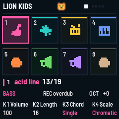

# LION KIDS

LION KIDS is an open-source groovebox firmware for the M‑VAVE FM‑1, with a free browser emulator. Choose one of eight colorful tracks, play a sound, and turn a few notes into a loop. Save up to three songs and give each a pixel-art name.

| Start here | |
| --- | --- |
| [Project homepage](https://daglitchboy.github.io/fm1-loom-kids/) | Screenshots, downloads and an overview |
| [Play in browser](https://daglitchboy.github.io/fm1-loom-kids/emu/) | Try the instrument on a computer |
| [Install on FM‑1](https://daglitchboy.github.io/fm1-loom-kids/install/) | Install the 0.0.4 firmware preview in Chrome or Edge |
| [User manual](https://daglitchboy.github.io/fm1-loom-kids/manual/) | Learn the panel controls and workflows |
| [Record & Export](https://daglitchboy.github.io/fm1-loom-kids/export/) | Back up saved device songs, export a loop, or record live stereo over USB |

Play synths, drums and sampled instruments. Record as you play, or edit the notes and drum hits in **Steps**. **Performance** shows all eight tracks while each plays its own 16-, 32- or 64-step loop. Add reverb, delay, an envelope, an LFO, Quick Effects or an arpeggiator directly from the panel.

The device preview is downloadable from the homepage with its corresponding source and checksums. See the [device build notes](docs/FM1_DEVICE_PREVIEW.md), [manual source](docs/LION_KIDS_MANUAL.md) and [release checklist](docs/RELEASE.md).

LION KIDS builds on **LOOM‑8 by Charles Vestal**, with **fm1-base** and **felucca-bsp**. The combined firmware and emulator builds use GPL-3.0-only. Individual files keep their original licenses. [LOOM‑8](https://github.com/charlesvestal/fm1-loom) · [Licensing and credits](LICENSING.md) · [GPLv3](COPYING) · [MPL 2.0](LICENSE)
