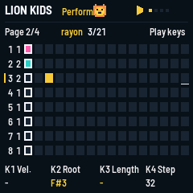
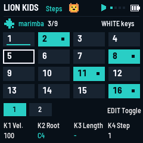

# LION KIDS user manual

## Get started

**In the browser.** Open the [LION KIDS emulator](https://daglitchboy.github.io/fm1-loom-kids/emu/) and press **Start LION KIDS**. Use a mouse, touch, or your computer keyboard. To play offline, extract the browser ZIP, run `python3 -m http.server 8000 --bind 127.0.0.1` in the extracted `lion-kids-web` folder, and open [127.0.0.1:8000](http://127.0.0.1:8000). Use `py -3` instead of `python3` on Windows if needed.

**On the FM‑1.** Back up your existing projects with your current firmware's backup tool. Connect the FM‑1 with a USB data cable, open the [installer](https://daglitchboy.github.io/fm1-loom-kids/install/) in desktop Chrome or Edge, and click **Install**. Allow MIDI access and follow the installer prompts. If it requests update mode, hold **OCT−** and **OCT+** together for five seconds. Leave the cable connected until the installer reports completion and the FM‑1 restarts. The installer includes a return-to-stock option.

Device slots are saved on the FM‑1. Emulator slots are saved in the current browser profile at the address you opened. Keep using the same browser profile, address and port to see those slots. Clearing that site's data removes its browser songs.

## Play and record

Turn **SELECT** to pick one of eight tracks, **PRESETS** to choose its category, and **ALGORITHM** to pick a sound. These knobs stop at either end. The track icon shows the category, and the counter shows the preset's position. On a new song the tracks are Acid Line, Marimba, Twill, Bellows, Dusty Pad, Breath Lead, Flute and Whisper Pad. Keys and Plucks start with reverb and delay.

- On **HOME**, K1 changes track volume, K2 changes the loop length (16, 32 or 64 steps), K3 chooses a chord mode, and K4 chooses a scale.
- **PLAY** starts or stops playback. In HOME and Performance, press **REC** while playing to overdub the selected track. If stopped, press REC and then PLAY. Press REC again to finish the take.
- **OCT−/+** changes octave. Turn **SELECT** to move to another track.

## Edit the loop

**SEQ** first opens **Performance**, where the keyboard plays live. Press SEQ again to switch to **Steps**. Further presses alternate views. After visiting another screen, SEQ reopens the view you last used.

| Control | Performance | Steps |
| --- | --- | --- |
| SELECT | Choose a track | Choose a track |
| K4 | Move the cursor on that track | Move the cursor on that track |
| K1 | Set the selected note's velocity | Set the selected note's velocity, or set velocity before adding it |
| K2 | Transpose the selected melodic note or chord | Transpose the selected note or chord. On an empty step, set the root for new notes |
| K3 | Set the selected step's length | Set the selected step's length |
| Keys | Play live | White keys toggle steps on the visible page. Black keys choose a hit on drum tracks |
| EDIT | Add or remove the note or last played drum hit at the cursor | Add or remove the note or selected drum hit at the cursor |

K4 moves between pages and wraps at the ends of the current track. For example, turning left from step 1 of a 32-step track selects step 32. Each track has its own cursor. In Performance the rows follow their own loops while playing. Turning K4 lets you inspect the current track independently until you start or stop playback or change views. On a drum step, velocity can be changed for the selected hit. Length applies to the step's group of hits. **Auto** uses the pattern's default note length.

## Shape your sound

On HOME, K3 moves from single notes to chords. Options include chords built from the selected scale, major, minor, power chords, seventh chords and octaves. K4 chooses the scale. When a scale is active, a key outside the scale is mapped to a playable note.

## Add effects

| Button | Panel | K1 / K2 / K3 / K4 |
| --- | --- | --- |
| FX | Reverb | Amount / decay / room size / tone |
| SEL | Delay | Amount / feedback / beat division / tone |
| EDIT outside Performance, Steps and GLO | Quick FX | Low-pass / drive / bitcrush / chorus |
| ENV | Envelope | Attack / hold / sustain / release |
| LFO | Modulation | Depth / target / rate / waveform |
| ARP | Arpeggiator | Order / rate / chord / scale |

A lit effect button means it is enabled on the selected track. Pressing it from another panel opens its controls and keeps an active effect enabled. Press it again in that panel to switch it off. A quick double press from another effect panel returns to the panel you came from. Reverb and delay amounts are independent per track. Their other settings are shared within the song.

- **ENV** draws the current envelope. Attack is the rise, hold is the time at the top, sustain is the level while you hold the note, and release is the fade after you let go.
- **LFO** can modulate volume, cutoff or drive. Negative depth inverts the modulation. Rate follows the song's tempo, and waveform selects sine, triangle, saw or square.
- **ARP** plays held notes in order. Select up, down, up–down, down–up or random, then set a tempo division. Chord and scale controls work with the arpeggiator.
- **Quick FX** knobs set how much of each effect the track uses. A setting of zero gives you the dry signal for that effect.

## Save, open or clear a song

Press **GLO**. K1 sets the tempo, K2 sets the metronome level, K3 sets swing for the selected track, and K4 previews song slots 1–3. Press **EDIT** to open the previewed song. **SAVE** writes to the currently loaded slot. To clear the selected slot, hold **GLO for five seconds**, then confirm with EDIT or cancel with HOME. The confirmation closes after five seconds.

Hold **EDIT** on GLO to open the pixel-name editor. K1 selects the canvas, K2 and K3 move the cursor, and K4 chooses and paints a color. PLAY paints with the current color, SEL resets the canvas, EDIT assigns the picture, and HOME leaves the editor. The templates autosave. A song keeps its own copy of the picture you assign.

Hold **HOME** and turn K1 left to undo or right to redo. The session holds up to ten recent edits. The browser also includes song saves and deletions in its history. On the FM‑1, saving, opening and clearing slots take effect outside edit history. Undo history clears on restart.

## Export or record to a WAV

Use [Record & Export](https://daglitchboy.github.io/fm1-loom-kids/export/) in desktop Chrome or Edge with firmware 0.0.3 or later.

**Download saved songs.** Press **SAVE** for each song you want to keep and stop playback. On the page, click **Read songs from FM‑1** and allow MIDI access. Choose **Download song backup** to save all three slots to one `.lionkids` file. **Open song backup** reloads the file on the page for future WAV exports. This preview uses the backup file for archiving and rendering. Keep a copy wherever you store your music.

**Export a song as audio.** Click **Export WAV** beside a filled slot. The browser renders one full cycle of the song, then lets the delay and reverb tails fade. The metronome is muted in an offline export.

**Record a live performance.** Click **Find audio inputs** and allow audio access. Choose the FM‑1 stereo input, click **Record live**, and play. Listen through the FM‑1. Click **Stop**, then **Download recording** to save the stereo WAV. The recording stays in the browser until you download it.

## Computer keyboard

| Shortcut | Control |
| --- | --- |
| Q–I, A–K | White keys |
| 1–0, minus | Black keys |
| Up / Down away from a focused knob | SELECT |
| Tab, then arrow keys | Focus and turn a knob |
| Space / Return from the panel | PLAY / REC |
| / | SEQ |
| O / N / V | GLO / EDIT / SAVE |
| Esc | HOME |
| Z / X | OCT− / OCT+ |

You can also click the panel buttons and drag or scroll over the knobs. Tab moves focus between controls. Space or Return presses a focused panel button.
