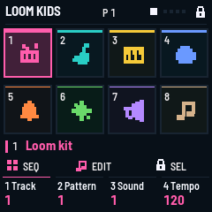
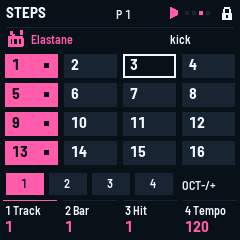
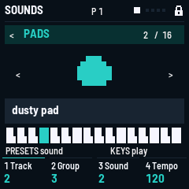

# LOOM Kids — visual UI redesign

Feature branch: `feat/loom-kids-ui`. Original source: `setup/loom-kids-codex` at
`475e3f5a5f03b76cb325ff09ef927afae13996e0`. This redesign starts from the protected vertical slice
`decb768bda305886c778a8758842d52ea198bade` and supersedes its Debug-menu entry and text-heavy screens.
The user explicitly expanded scope to include the real instrument/preset browser.

## Start on a Mac

From the existing checkout, with the working Pillow/RAQM environment and Emscripten installed:

```sh
git switch feat/loom-kids-ui
git pull --ff-only
source .venv/bin/activate
PYTHON="$PWD/.venv/bin/python" ./build.sh --web &&
python -m http.server 8000 --bind 127.0.0.1 --directory app/build/emu
```

Open <http://localhost:8000>, hard-reload an old tab (Command–Shift–R), and start the emulator.
The page now says **LOOM Kids**. It opens directly into adult PIN setup; there is no Debug-menu detour.
Use K1–K4 to choose a four-digit session PIN, press SEL, enter it again and press SEL. The colorful Stage
appears. The page's **Kids-Modus öffnen** button also returns from Studio directly to Kids after startup.

The native host remains Studio by default for the original regression scenarios. Run `LOOM_KIDS=1`
with the host executable to exercise the same direct Kids entry as the browser. Debug → HOME remains
only a compatibility fallback for native scripts, not the browser's primary entry.

## What changed visually and musically

- **Stage / HOME:** eight large color-coded instrument cards, each with a distinct procedural pixel-style
  icon and a stable number. The first four have stronger accent bars. White keys 1–8 select tracks directly.
  The selected sound's actual name is shown. Grid, note and lock symbols explain SEQ, EDIT and SEL.
- **Steps / SEQ:** a spacious 4×4 step grid, with full colored cells for active steps and a bright moving
  playhead outline. Four visible bar tabs cover all 64 steps; disabled-length cells are dimmed. Drum cells
  show the selected hit, without deleting other hits. Musical editing still calls the original step helper.
- **Sounds / EDIT:** a large instrument/category icon, category and position/count, the real preset name,
  and a preview keyboard. K2 selects Bass, Keys, Pads, Leads, Plucks, Textures or All. K3/PRESETS selects
  a matching factory preset or, under All, a nonempty saved user preset. Presets can span melodic engines.
  Drum tracks browse factory and saved drum kits instead of being silently converted into melodic tracks.
  The piano keys really audition the current sound. Track, page and preset changes release held notes.
- **Motion:** Stage icons rise/light when their track has a trigger at the actual playhead; the header
  indicates the actual step/transport. The sound icon responds to pressed keys. These are state-driven
  changes, with no timer animation, idle redraw, extra framebuffer or bitmap assets.
- **Panel feedback:** HOME/SEQ/EDIT light for the actual Kids page; Stage highlights track keys, Steps
  shows the selected hit/playhead, and Sounds shows played keys. SAVE does not misleadingly light in Kids.

Screenshots from the executable, not mockups:





## Consistent controls

| Control | Stage | Steps | Sounds |
| --- | --- | --- | --- |
| HOME / SEQ / EDIT | Stage / Steps / Sounds | Stage / Steps / Sounds | Stage / Steps / Sounds |
| SEL | Adult PIN gate | Adult PIN gate | Adult PIN gate |
| ALGORITHM or K1 | Track 1–8 | Track 1–8 | Track 1–8 |
| PRESETS | Sound | Sound | Sound |
| SELECT | Pattern | Pattern | Pattern |
| K2 | Pattern | Bar 1–4 | Sound group (unused for drum kits) |
| K3 | Sound | Drum hit or inserted MIDI note | Sound |
| K4 | Tempo | Tempo | Tempo |
| OCT−/+ | Viewed bar | Viewed bar | Viewed bar |
| White keys | Track 1–8 | Toggle the 16 steps of the viewed bar | Play the selected sound |
| Black keys | No action | Select a drum hit | Play the selected sound |
| PLAY | Start/stop | Start/stop | Start/stop |

The four live knob labels remain visible; button names match the actual panel. PRESETS no longer means
pattern in Kids. A pattern change during playback uses the original queued-pattern mechanism. The header
shows both current and pending patterns. Notes played on Sounds become the next melodic note inserted.
Changing a sound applies immediately to the working copy; it does not erase that track's pattern.
Studio retains full recording, chords, FX, envelopes, LFO, mixer, arrangement, presets and save access.

## Saved-work and adult-access protection

An adult chooses a private PIN twice before starting Kids. SEL opens the adult gate, never Studio directly.
Wrong PINs have a three-second delay; cancelling/reopening does not bypass it. HOME cancels a PIN prompt.

Kids detaches the loaded model from its saved slot (`proj_slot = NPROJ`) and blocks autosave. No extra
project snapshot or save-format change is needed. The work remains unsaved even after adult unlock.
Studio's SAVE flow requires confirmation before overwriting an existing slot. Cancelling writes nothing.
A simulated reboot reloads saved music, detaches it again and stays locked within the current session.

This is a **session UI guard**, not OS/browser parental control. Closing/reloading the emulator ends the
session and discards unsaved edits. A fresh browser start asks for adult setup again. PINs are not stored
in project files or browser storage. Developer tools and host scripts are outside this UI boundary.

## Code and tests

- `app/kids.c`: procedural drawing, per-band signatures, preset/kit browsing through existing helpers,
  audition input, page-specific panel feedback, detached working copy and PIN gate.
- `app/ui.c`: emulator-only startup and explicitly labelled browser entry, dispatch and autosave guard.
- `app/host.c`: assertions and a simulated press of the same browser entry control.
- `app/web/emu/page.html`, `app/web/emu/app.js`: Kids branding, clear controls, direct-entry button.
- `tests/host/kids_redesign.xy`: direct startup, all eight tracks, kit/preset/category changes, measured
  audition audio, held-note release, per-track preset retention, patterns, step 64, PIN and direct re-entry.
- `tests/host/kids_web_controls.mjs`: actual browser module's entry binding, reconnect and inactive-emulator cases.
- `tests/host/kids_page_test.py`: real page-template composition, branding, entry and control documentation.
- `tests/host/emu_test.mjs`, `emu_page_test.mjs`: updated WASM/page tests for default Kids setup and new title.
- Existing Kids interaction/safety scenarios and saved-object byte comparisons remain in the full runner.

Verification commands:

```sh
./build.sh --host
mkdir -p app/build/scenarios/kids_redesign
LOOM_KIDS=1 app/build/host/loom_host tests/host/kids_redesign.xy app/build/scenarios/kids_redesign
tests/run_tests.sh
```

The direct-entry scenario asserts no extra redraws over one idle second, real audible drum preview,
zero held voices after switching tracks, and that sound selection does not clear drum steps. Safety tests
compare every saved byte after Kids edits (now including kit selection), unlock and cancelled overwrite;
only the explicit adult save may change them. Screenshots are also checked by the host layout audit.

The full available suite passed 96 checks. After the final keyboard display and tooltip changes,
the direct-entry scenario, browser entry JavaScript and page composition passed again. The host
executable grew by 13,080 bytes of text and 64 bytes of data compared with `decb768`. BSS was unchanged.

Web limitation: this environment has no Emscripten. Installing SDK 4.0.20 was attempted, but its Google
Storage download returned proxy HTTP 403; the package-manager mirror was also blocked. Therefore the
WASM build and WASM execution tests cannot be claimed as passed here. Native C behavior, actual page
composition and browser entry JavaScript are tested separately. The Mac build remains `./build.sh --web`.
Other existing skips: no firmware package for update tests, and no pre-existing DSP fingerprint reference.

## Scope and next step

No physical hardware communication, firmware build/flash, install/recovery command, bootloader/flash-layout
change, submodule modification, DSP/timing change or project/preset serialization change. All Kids code
is guarded for host/web emulation. Original licenses and notices remain.

Still deferred: dedicated child-friendly recording, arrangement, mixer, FX/envelope/LFO controls, visible
undo/redo and complete spoken/large-type Kids navigation. These capabilities remain in adult Studio.
Next narrow step: a few clearly named sound macros and an obvious undo action, followed by recording and
scene workflows. Actual hardware RAM/stack/render performance is not inferred from host measurements.
