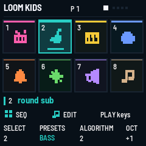

# Delivery 1 · Playable HOME

The emulator starts in Kids mode on the eight-track HOME screen. Play the keys immediately. SELECT chooses a track, PRESETS chooses a sound category, and ALGORITHM chooses a sound in that category. All three lists wrap. OCT− and OCT+ transpose the melodic keyboard by twelve semitones. Drum keys keep their hit assignments. HOME returns to the playable screen, and PLAY starts or stops the current pattern.

The current Steps and Sounds views remain available with SEQ and EDIT. The three encoders keep their HOME roles in both views. SEL is available for the delay controls in Delivery 4. The old startup PIN and Studio entry prompt have been removed. To run Studio in the native host, start it without the `LOOM_KIDS` environment variable and use a Studio scenario. Kids mode works on an unsaved copy.

When a track changes between a drum kit and a melodic sound, it keeps the other pattern bank in the running session. This includes all eight patterns and their parameter locks. The new bank starts empty on the first switch. Switching back brings back the original material. The native audio engine has three drum-kit voicesets, so Kids refuses a fourth simultaneous kit and keeps that track's sound. Any of the eight tracks can use one of the three. Recording and the HOME controls for volume, length, chords and scales belong to Delivery 2. Saving both pattern banks belongs to Delivery 7.

## Try it on macOS

From the existing checkout with Emscripten and the Python environment used by your previous build:

```sh
git fetch origin refs/heads/feat/kids-playable-home:refs/remotes/origin/feat/kids-playable-home
git switch --track origin/feat/kids-playable-home
PYTHON="$PWD/.venv/bin/python" ./build.sh --web &&
python3 -m http.server 8000 --bind 127.0.0.1 --directory app/build/emu
```

If the local branch already exists, use `git switch feat/kids-playable-home` and `git pull --ff-only`. Open [localhost:8000](http://localhost:8000) and press Start. Use the arrows or drag SELECT to select another track. Start with the piano keys on track 1, then switch to a melodic track and try OCT+.



[Audio captured from the playable HOME scenario](kids-playable-home.mp3)

Native test entry:

```sh
./build.sh --host
mkdir -p app/build/scenarios/kids_redesign
LOOM_KIDS=1 app/build/host/loom_host tests/host/kids_redesign.xy app/build/scenarios/kids_redesign
tests/run_tests.sh
```

The host build and all 96 available checks passed. The new scenario checks audible HOME input on track 8, track/category/preset wraparound, octave pitch, key release after a switch, kit capacity, and restoration of chords, parameter locks and drum hits. A separate scenario compares persisted Studio project bytes before and after Kids edits and a reboot. The HOME scenario made 64 blits in 3.72 simulated seconds. The native executable has 3,432,824 bytes of BSS, 736 more than the previous redesign build. Inactive banks allocate about 6.1 KiB per switched track plus the stored lock lanes. Allocation takes place during a sound change.

The page and JavaScript tests passed. The WebAssembly build requires Emscripten, which is unavailable in this environment. The SDK download returned HTTP 403. The runner also skipped firmware update checks and the optional reference DSP hashes because their inputs were unavailable.
