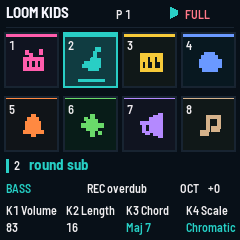

# Delivery 2 · Playing and recording

Start on HOME and use the first four knobs to shape the selected track.

| Knob | HOME control |
| --- | --- |
| K1 | Track volume |
| K2 | Active pattern length, 16, 32 or 64 steps |
| K3 | Single, In scale, Major, Minor, Power, Minor 7, Octaves, Major 7 |
| K4 | Chromatic, Major, Minor, Major pentatonic, Minor pentatonic, Dorian, Egyptian |

Shortening a pattern hides its later steps. Extending it brings them back. Chord and scale choices are per track for the current session. Scales use C as tonic and snap to the nearest playable pitch, preferring the lower pitch in a tie. In scale builds a triad from alternating scale degrees. Fixed shapes keep their intervals around the snapped root. Drum tracks keep their regular hits and show dashes for chord and scale. Monophonic presets keep their native single-voice behavior.

Tap REC on HOME or Sounds. If stopped, the display shows **ARMED** until PLAY starts the take. If already playing, REC begins the take immediately. The REC light illuminates and the display reads **REC** while recording. Tap REC again to end the take and keep playback going. Changing tracks, entering Steps, changing instrument type, or changing loop length also ends the take. PLAY stops playback and recording.

Recording adds notes and hits to the selected track's current pattern. The original notes take priority over newly played notes, and the first four distinct pitches fit into a melodic step. The display briefly shows **FULL** if another pitch arrives. A chord is passed to the existing recorder as the actual notes played. In Kids, the original Studio conductor does not re-map those pitches. Steps and Sounds remain available, and SELECT, PRESETS and ALGORITHM retain the roles documented in Delivery 1.

## Run it on a Mac

From the existing checkout, with Emscripten and the Python environment used for Delivery 1:

```sh
git fetch origin refs/heads/feat/kids-musical-keys:refs/remotes/origin/feat/kids-musical-keys
git switch --track origin/feat/kids-musical-keys
PYTHON="$PWD/.venv/bin/python" ./build.sh --web &&
python3 -m http.server 8000 --bind 127.0.0.1 --directory app/build/emu
```

If the local branch already exists, switch to it and run `git pull --ff-only`. Open [localhost:8000](http://localhost:8000), start the emulator, and select track 2 to try a scale and a chord shape. To hear all chord tones together, pick a polyphonic keys or pad preset. Try arming REC, pressing PLAY, playing a few notes, ending the take with REC, then playing the loop back.



## Verification

The unit test covers every piano key at all nine supported octave positions across seven scales and eight voicings. The host scenario checks per-track level, loop length and restoration of hidden steps, overlapping pitch ownership, mono and poly presets, melodic and drum recording, audible playback of the recorded loop, overdub overflow, and cancellation on track/view changes.

To run the scenario directly:

```sh
./build.sh --host
mkdir -p app/build/scenarios/kids_music
LOOM_KIDS=1 app/build/host/loom_host tests/host/kids_music.xy app/build/scenarios/kids_music
```

All 98 available checks passed in `tests/run_tests.sh`. The browser page and JavaScript checks ran. The WebAssembly build was skipped because Emscripten is unavailable. The firmware update and optional DSP fingerprint checks were skipped because their artifacts were absent. The host executable added 288 bytes of BSS compared with Delivery 1. The musical-key scenario rendered 97 blits across 4.386 simulated seconds.
