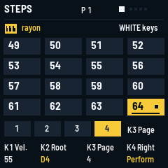
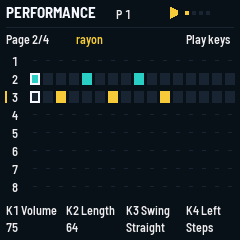

# Delivery 3 · Steps and Performance

Press **SEQ** to open Steps. Turn **K4 right** for Performance and **K4 left** to return to Steps.

| Knob | Steps | Performance |
| --- | --- | --- |
| K1 | Velocity of the last touched step or selected kit hit | Selected track volume |
| K2 | Root note for new melodic steps | Selected track length |
| K3 | Manual page within this pattern | Swing amount |
| K4 | Right opens Performance | Left opens Steps |

**Steps.** The 16 white keys toggle the displayed cells. On a drum track, the black keys select the individual hit. On a melodic track, black keys have no action here. The most recently touched cell has an underline. K1 can change the next insertion's velocity after you remove a note or hit, and the cell stays empty until you toggle it again. Velocity changes to one drum hit preserve the other hits in the same cell. K2 sets the root of new melodic steps, using the track's HOME chord and scale choices. K3 changes the manual page, which stays put during playback. OCT−/+ still changes octave. Shortening the loop hides later notes and clamps the manual page to the shorter loop.



**Performance.** The eight rows show the same 16-step window. The window advances with the selected track during playback and stays on its last valid page when playback stops. Outlined cells show each row's playhead when it falls within the window. Colored cells are occupied and small dashes mark positions beyond that track's length. The keys play live. Use REC to overdub. Returning to Steps ends the take. Swing starts at Straight and uses the original LOOM timing engine. Adjusting it switches a project with an imported groove type to Swing, which is a shared timing shape. The amount is set on the selected pattern.



## Try it on a Mac

From the existing checkout and with Emscripten available:

```sh
git fetch origin refs/heads/feat/kids-sequencer-views:refs/remotes/origin/feat/kids-sequencer-views
git switch --track origin/feat/kids-sequencer-views
PYTHON="$PWD/.venv/bin/python" ./build.sh --web &&
python3 -m http.server 8000 --bind 127.0.0.1 --directory app/build/emu
```

If the local branch already exists, switch to it and pull with `git pull --ff-only`. Open [localhost:8000](http://localhost:8000) and start the emulator.

The native scenario in `tests/host/kids_sequencer.xy` exercises simultaneous 16-, 32- and 64-step patterns, the 1→2→3→4→1 page cycle, step 64 after shortening and extending, fixed editor paging, independent drum hit velocities, playable Performance keys and live overdub. Run it with `LOOM_KIDS=1` after `./build.sh --host`, or use `tests/run_tests.sh` for the full suite.

All 99 available checks passed. The browser page and JavaScript tests ran. WebAssembly was skipped in this workspace because Emscripten is unavailable. The firmware update test and optional DSP fingerprints also lacked their inputs. The host build kept BSS at 3,433,112 bytes, the same as Delivery 2. The scenario rendered 566 blits across 12.665 simulated seconds.
