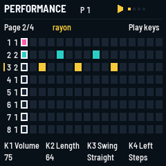
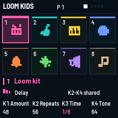

# Delivery 4 · Independent loop pages, effects and arpeggiator

In Performance (**SEQ**, then **K4 right**), each row follows its own loop. A 16-step track always shows page 1, a 32-step track alternates between pages 1 and 2, and a 64-step track cycles through four pages. The number beside each track is that row's current page. The header shows the selected track's page and total. Stopping holds the last page for each row. The Steps editor still uses its manual page.



**FX**, **SEL**, **ARP** and **GLO** keep the playable eight-track stage and change the knob strip. SELECT, PRESETS, ALGORITHM and OCT keep their normal functions.

| Button | K1 | K2 | K3 | K4 |
| --- | --- | --- | --- | --- |
| FX · Reverb | Amount | Decay | Room size | Tone |
| SEL · Delay | Amount | Repeats (feedback) | Synced time | Tone |
| ARP · Arpeggiator | Order | Synced rate | Chord | Scale |
| GLO · Global | BPM | Click volume | — | — |

**Reverb and delay.** Each track has its own switches and remembered amounts. The button LEDs show the selected track's switches. Both effects can run at the same time. Pressing a lit effects button stops that track from feeding its effect, lets the existing tail fade and returns the strip to HOME. K2–K4 shape a shared reverb or delay, so their settings apply to any track feeding the corresponding effect. Delay time offers 1/16, 1/8 triplet, 1/8, dotted 1/8 and 1/4 where they fit the native buffer. If a slower BPM makes a choice too long, the display shows the longest division that still fits. The earlier choice returns when the tempo allows it.



**Arpeggiator.** Press ARP on a melodic track and hold a key with a chord selected. The note order can be Up, Down, Up-down, Down-up or Chaotic. Rate is always BPM-synced. Live recording stores the held chord so changing the arpeggiator later changes how it plays back. Drum kits show “Melodic only.”

**Global.** K1 sets 40–220 BPM. K2 sets the metronome volume, with Off at the left stop. Song slots arrive in Delivery 7. ENV, LFO and the EDIT quick effects are scheduled for Delivery 5.

## Try it on a Mac

From the existing checkout, with your Python environment and Emscripten available:

```sh
git fetch origin feat/kids-native-effects:refs/remotes/origin/feat/kids-native-effects
git switch --track origin/feat/kids-native-effects
PYTHON="$PWD/.venv/bin/python" ./build.sh --web &&
python3 -m http.server 8000 --bind 127.0.0.1 --directory app/build/emu
```

Open [localhost:8000](http://localhost:8000) and start the emulator.

## Verification

The host suite exercises the mixed-length Performance grid, selected-track LEDs and effect amounts, independent bypass, synced delay impulse times, all five arpeggiator orders, recorded chord replay and metronome Off. WAV checks cover both returns together, tails after bypass and click gain. Run it with `sh tests/run_tests.sh`.

All 101 available checks passed. The host build used 3,433,208 bytes of BSS, up 96 bytes from Delivery 3. The WebAssembly build was skipped because Emscripten was unavailable. The firmware update test and optional DSP fingerprint test lacked their inputs.
