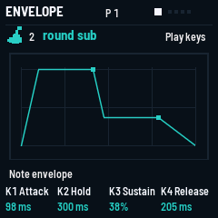
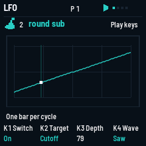
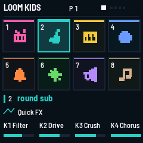

# Delivery 5 · Envelope, LFO and quick effects

**SEQ opens Steps. K4 left opens Performance. K4 right returns to Steps.** Each view has an end stop. Performance still turns pages independently for each track.

| Button | K1 | K2 | K3 | K4 |
| --- | --- | --- | --- | --- |
| ENV | Attack | Hold | Sustain level | Release |
| LFO | Off / On | Volume, cutoff or drive | Depth | Sine, triangle, saw or square |
| EDIT | Low-pass | Distortion | Bitcrush | Chorus |

The LEDs show which effects are enabled for the selected track. Pressing a lit button bypasses its effect and returns to HOME. Pressing it again recalls the track's settings. HOME closes the current controls while the effects keep playing. On the LFO graph, K1 can also switch modulation off and on while keeping the graph open. SELECT, PRESETS, ALGORITHM, octave, live keys and transport work on both graphs.



**Envelope.** The attack rises to full level and holds there for the displayed time. A fixed 60 ms decay leads to the selected sustain level. Releasing a key starts the release from the current level, including during the attack or hold. Bypass restores the preset's amplitude envelope. Kit hits use the same shape as a per-hit gain curve on top of the drum model. One-shots, finite samples and synths with an internal sound decay can end sooner than the graph. The flat sustain segment previews 300 ms. On a held note, sustain lasts until release.



**LFO.** Each track can pick its own target, depth and waveform. The period is one 4/4 bar at the song tempo. The phase starts at the beginning of the cycle on PLAY and also runs while stopped for live playing. The marker follows the audio phase during playback and while keys are held. Volume modulation attenuates the track and its sends together. Cutoff and drive modulate the track's sound.



**Quick effects.** EDIT keeps the eight-track stage and shows four wet-amount bars. Zero is dry. The effects run in order through low-pass, soft distortion, a reduced-rate crusher and a stereo chorus. These inserts color the direct track sound. FX and SEL continue feeding their own reverb and delay independently, preserving the native per-hit send balance on kits.

## Try it on a Mac

From the existing checkout, with the project's Python environment and Emscripten available:

```sh
git fetch origin feat/kids-envelope-lfo-quick-fx:refs/remotes/origin/feat/kids-envelope-lfo-quick-fx
git switch --track origin/feat/kids-envelope-lfo-quick-fx
PYTHON="$PWD/.venv/bin/python" ./build.sh --web &&
python3 -m http.server 8000 --bind 127.0.0.1 --directory app/build/emu
```

Open [localhost:8000](http://localhost:8000) and start the emulator.

## Verification

All 107 available checks passed, including the browser build and 1,264 unchanged native DSP fingerprints compared with Delivery 4. The firmware update test was skipped because it requires a firmware package.

The host scenario and WAV analysis cover the timed hold, early release, preset bypass, kit shaping, LFO timing at 90 and 120 BPM, cutoff and drive, the individual quick effects, concurrent quick effects and sends, and track isolation. The WebAssembly test plays all eight tracks with overlapping chords and checks audio levels and the time to render 128-frame blocks at 44.1 kHz. Use `sh tests/run_tests.sh` or run the comparison directly with `node tests/host/kids_dsp_web.mjs app/build/emu/app.wasm /path/to/delivery-4/app.wasm`.

In a native eight-track stress run, render time was 4.2% of real time on Delivery 4 with both sends, 5.5% on Delivery 5 with just the sends, and 14.0% with the new processing and both sends. The final WebAssembly stress run measured a 1.70 ms p95 for the full chain against a 2.90 ms block budget.

On this Linux host, a headless Chromium AudioWorklet ran the eight-track pattern in real time. Its reported render load was 2–5% on Delivery 4 with both sends, and 12–15% on Delivery 5 with both sends and all new processing. The host build uses 3,500,280 bytes of BSS, an increase of 67,072 bytes, primarily for per-track mix buffers and chorus delay lines. This is an emulator measurement. A device port needs its own memory and timing budget.

The controller and graphs are in `app/kids.c`. The new gain shape lives in `app/dsp/kids_dsp.h` and the insert in `app/kids_insert.c`. The synth, drumline and engine apply these only in the emulator builds. The next planned delivery is the five-action undo/redo journal.
