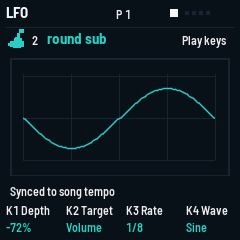
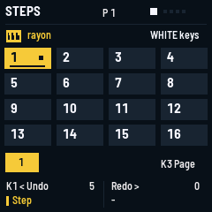

# Delivery 6 · Effect focus, LFO rates and undo

## Effect buttons and LFO

FX, SEL, ENV, LFO, EDIT and ARP keep their own enabled state per track. Press an effect button to open its controls. If the effect is off, that press also enables it. Press the same button again while its controls are open to bypass it and return to HOME. For example, while adjusting reverb, press SEL to adjust the delay with both effects still enabled.

| LFO knob | Function |
| --- | --- |
| K1 | Depth from −100% to +100%. Negative values invert the wave. Zero gives neutral modulation. |
| K2 | Volume, cutoff or drive |
| K3 | Two bars, one bar, 1/2, dotted 1/4, 1/4, 1/4 triplet, 1/8, 1/8 triplet, 1/16 or 1/16 triplet |
| K4 | Sine, triangle, saw or square |

Each track keeps its own rate. One bar is the default. The phases align at PLAY and continue from their current position when you turn the rate knob.



## Undo and redo

Hold **HOME** to open the history strip. Turn **K1 left** once per action to undo, or **right** to redo. Release HOME to return to the same screen. A quick HOME tap still opens the stage.



The last five musical edits are available across tracks. A continuous sweep on one knob counts as one action. Switching sounds, including a drum-to-melody switch, is one action. A recording take is committed when it ends. Turning K1 in the history strip closes an active take first, so it can be undone immediately. Playing the keys, changing track focus, and starting or stopping transport without a take are outside history. A new edit after undo clears the redo branch.

History is session-local. Delivery 7 adds song slots and undo for writes to the song shelf.

## Try it on a Mac

From the existing checkout, with the project's Python environment and Emscripten available:

```sh
git fetch origin feat/kids-history:refs/remotes/origin/feat/kids-history
git switch --track origin/feat/kids-history
PYTHON="$PWD/.venv/bin/python" ./build.sh --web &&
python3 -m http.server 8000 --bind 127.0.0.1 --directory app/build/emu
```

Open [localhost:8000](http://localhost:8000) and start the emulator.

## Verification

The native scenarios verify five exact undo and redo steps, sixth-action eviction, redo invalidation, grouped knob turns, alternate pattern banks and drum velocity, pending step velocity, and a recording take with an intervening volume edit. The audio test measures an inverted quarter-note LFO at 120 BPM. The WebAssembly test exercises opening a lit effect, undo and redo using HOME and K1, and eight-track audio.

`app/kids_history.c` stores the changed byte ranges and retains the old alternate bank only for a track-type switch. Its two scratch captures are used from UI code. Older journal entries are freed when evicted. The tests also compare the native Studio DSP output with the Delivery 4 fingerprints.

All 109 available checks passed. The update-path test requires a firmware package and was skipped. Host BSS was 3,531,704 bytes, up 31,424 bytes from Delivery 5. The journal payload was 36 bytes for the five mixed edits and 12,808 bytes in the test with retained alternate banks. If an allocation fails, the working song is retained and the history strip reports that the journal could not be kept.
