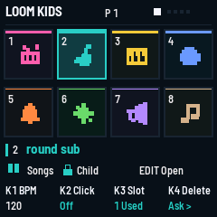
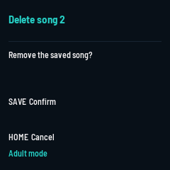

# Delivery 7 · Three songs and ten undo steps

> This page documents the original Delivery 7 branch. See the [updated shelf guide](KIDS_PIXEL_SHELF.md) for the current controls.

## Effect buttons and history

While adjusting an effect, a quick double-press on a different effect button switches that effect off and returns to the original panel. The two presses must be within 300 ms. A later press while adjusting the effect switches it off and returns to HOME.

Hold **HOME** and turn **K1 left** to undo or **right** to redo. Ten actions are kept, including opening, saving, replacing and deleting songs. A new edit after undo clears the redo branch. History resets when the emulator restarts. Each successful save, replacement and deletion takes effect in the shelf immediately, including when replayed through history.

## Songs

**GLO** opens the shelf. K1 and K2 remain tempo and click volume. Turn **K3** to browse three slots, then **press EDIT to open** the highlighted song. Browsing never changes the eight tracks. Opening brings back the saved track sounds, kit settings, patterns and effects. Selecting an empty slot keeps your working song as it is.

If you have unsaved edits, the Open prompt offers **SAVE** to keep a copy in an empty slot, **EDIT** to discard your edits and open, or **HOME** to cancel. SAVE captures the song at the instant you press it, including the notes already recorded in an active take. Finish recording before opening a different song.



In **Child** mode, SAVE writes to the highlighted slot if empty or the next free slot. Once all three are occupied, SAVE requests the PIN and then asks for a separate confirmation. To delete, highlight a slot in GLO, turn **K4 right**, and follow the prompt. HOME or a left turn cancels the delete prompt.



Set an optional four-digit PIN in the browser settings below the instrument. On the instrument, use the first ten white keys for digits **1 through 9, then 0**, and press SAVE to check it. Press SAVE again to confirm the selected operation. Without a PIN, use the adult shortcut for replacement or deletion.

**Five distinct GLO presses within three seconds** toggle Adult mode. Adult SAVE writes directly to the highlighted slot. Delete still asks for confirmation. Each emulator launch starts in Child mode. This is a convenience protection for the song shelf.

## Try it on a Mac

Use your existing clone, Python environment and Emscripten.

```sh
git fetch origin feat/kids-song-shelf:refs/remotes/origin/feat/kids-song-shelf
git switch --track origin/feat/kids-song-shelf
PYTHON="$PWD/.venv/bin/python" ./build.sh --web &&
python3 -m http.server 8000 --bind 127.0.0.1 --directory app/build/emu
```

Open [localhost:8000](http://localhost:8000) and start the emulator. Browser song slots are stored in IndexedDB for that browser profile and origin. A repeated host run can use an existing directory via `LOOM_KIDS_SHELF`. The optional `LOOM_KIDS_PIN` sets the host test PIN.

## Storage and verification

The shelf keeps native resolved track settings and patterns, a versioned Kids settings section, and the typed alternate pattern banks. It uses LOOM’s LZ codec and a CRC. User samples are referenced by their slot and the bank's fingerprint. Opening a song that needs an unavailable or changed user bank preserves the working song and reports that the bank is needed. Restore the referenced bank to open it.

On the host, each slot uses one atomic file replacement. In the browser, one IndexedDB transaction checks and updates the slot generation. It runs on the page thread and acknowledges success to the Worklet. A failed write, or an undo based on a stale generation, preserves the working song and history cursor. A stale slot needs a reload. The native Studio project objects are separate.

The native history and song scenarios exercise ten-action eviction, fast and slow effect switches, slot browsing, protected save and delete, PIN rejection and cancellation, typed banks, reload, preserved transport behavior during history replay, and undo/redo of load and slot writes. The byte comparison checks exact restored payloads and the untouched slot files, plus corrupt and failed-write cases.

A Chromium smoke test exercised the real page, AudioWorklet and IndexedDB. It saved a song, undid and redid the write, reloaded the page, opened the song, rejected an incorrect PIN and confirmed a deletion with the correct PIN.

The maximum encoded song is 180,320 bytes. The native fixtures saved to about 2.8 KB each. Ten entries with two distinct worst-case song images each would use under 3.7 MB for payloads, and history shares images with the shelf where possible. This fits the emulator's 32 MB WebAssembly memory. The host's static BSS grew by 864 bytes from Delivery 6.

All 111 available checks passed, including the browser build. The firmware update test was skipped because it requires a firmware package.
