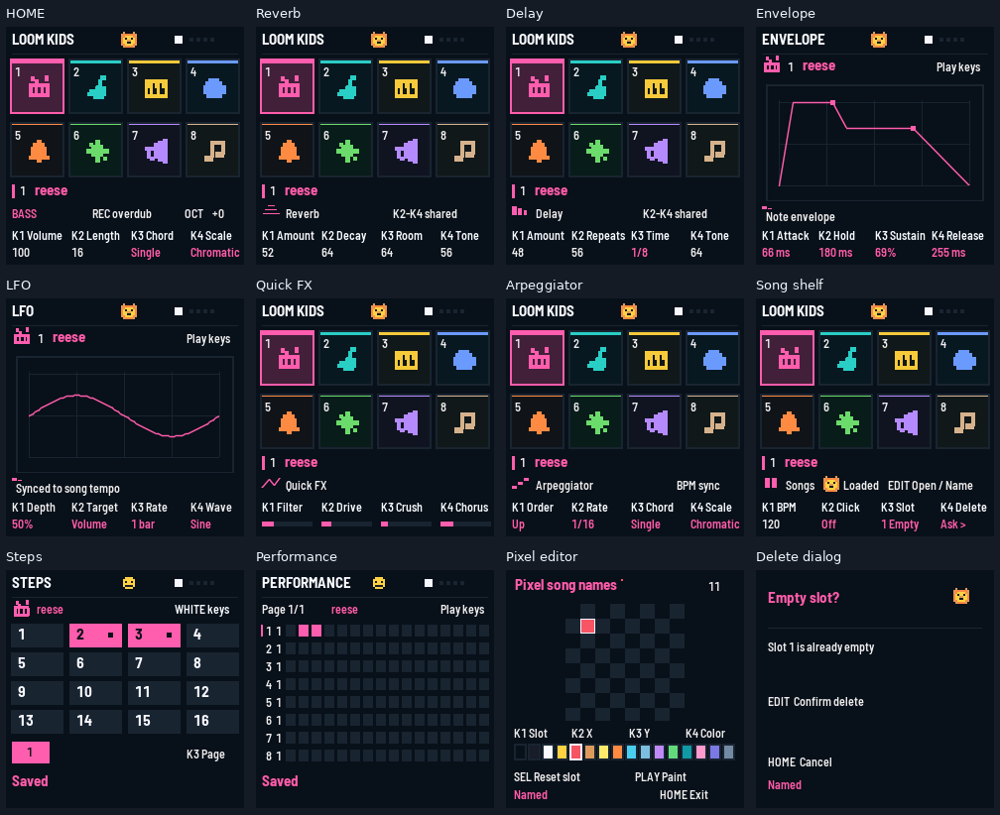

# Delivery 8 · Browser release candidate

This is the Delivery 8 handoff. See the [current manual](../LION_KIDS_MANUAL.md) and [release checklist](../RELEASE.md) for current controls and downloads.

One click on **LION KIDS starten** switches on the instrument. On first use, slot 1 opens on HOME with all patterns empty. On later starts, the emulator opens the last loaded slot. [Starter sounds, categories and release review](LION_KIDS_RELEASE.md) · [Song slots and pixel names](KIDS_PIXEL_SHELF.md)

## Try it on a Mac

Download the web emulator artifact from the [LION KIDS GitHub Actions workflow](https://github.com/vmphilemon-glitch/fm1-loom-kids/actions/workflows/lion-kids.yml) when a run is available. To build from source, open your existing repository checkout with Emscripten and Python with Pillow and libraqm installed.

```sh
git fetch origin
git switch feat/lion-kids-sequencer-release
git pull --ff-only
git submodule update --init --recursive
export PYTHON="$PWD/.venv/bin/python"
"$PYTHON" -c 'from PIL import features; assert features.check_feature("raqm"), "Pillow needs libraqm"' &&
  ./build.sh --web &&
  python3 -m http.server 8000 --bind 127.0.0.1 --directory app/build/emu
```

Open the same address and port you previously used to keep access to that browser profile's songs. For a fresh start the command above serves [127.0.0.1:8000](http://127.0.0.1:8000). Browser storage is specific to the origin, so `localhost` and `127.0.0.1` have separate shelves. If the font check fails on an Apple Silicon Mac, use the Python installation with Homebrew's Pillow as described in [BUILDING.md](../../BUILDING.md). The web build uses Emscripten and does not need the FM-1 device SDK.

| Keyboard | Control |
| --- | --- |
| Q through I and A through K | White keys |
| 1 through 0 and minus | Black keys |
| Up / down with no knob focused | SELECT track |
| Tab, then arrow keys | Focus and turn a knob |
| Tab, then hold Space or Return | Hold a focused button |
| Space / Return from the panel | PLAY / REC |
| / | SEQ |
| O / N / V | GLO / EDIT / SAVE |
| Esc | HOME |

Pointer clicks, scroll or drag on knobs, and button holds work through the same panel inputs. Hold **N** in GLO to open the picture editor. Hold **Esc** and turn K1 for undo or redo.

## Live recording

Previously Kids live recording used the Studio pattern's default 100% quantization, snapping onsets to sixteenth-note cells. Kids now keeps live onset offsets at 24 ticks per sixteenth, about 5.2 ms per tick at 120 BPM. Live notes can sound between steps, including near a 32nd-note position. The Steps editor still uses its sixteenth grid. Each cell has one onset shared by all its notes, so a full run of separate 32nd-note attacks still needs an additional event per cell. Timing uses the existing pattern bytes and adds zero bytes per recorded step.

## Browser verification

Chromium played a live note, recorded from HOME using keyboard shortcuts, and saved into slot 2. After reloading, it reopened the same slot and picture name and played the recorded loop. These Delivery 8 screenshots predate the final name and preset changes. They are from the WebAssembly build at the instrument's 240×240 resolution. [Short browser capture of recording and saving](../img/kids-browser-record-save.gif)



All 112 available checks passed, including the Studio regression scenarios. The firmware-package checks were skipped. The host executable used 3,533,208 bytes of BSS, 640 fewer than the prior branch. Physical hardware was outside this delivery.
