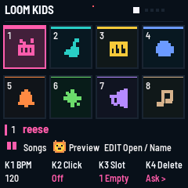

# Song slots and pixel names

- **GLO → K4** previews slots 1–3. The knob stops at both ends. **EDIT** opens the previewed slot, with its instruments, presets, settings and recordings.
- **SAVE** writes to the loaded slot. The emulator reopens the last loaded slot. A fresh shelf starts with slot 1 and empty patterns. Open another empty slot to start a new song with the starter sounds.
- **Hold GLO for five seconds** to open **Empty slot?** for the song in the preview. **EDIT** confirms. **HOME** cancels. The prompt also closes after five seconds. If you delete the loaded slot, your playing copy remains open and can be saved again.
- **Hold HOME and turn K1** left to undo or right to redo. The last ten actions can include saves, overwrites, deletes and names. History resets when the emulator restarts.

## Make a pixel name

Hold **EDIT** in GLO. The editor has ten starter symbols and five blank canvases.

| Control | Action |
| --- | --- |
| K1 | Choose a template, 1–15 |
| K2 / K3 | Move across columns / rows |
| K4 | Select a color and paint the current pixel |
| PLAY | Paint with the selected color |
| SEL | Reset the template to its original symbol or blank canvas |
| EDIT | Name the loaded song |
| HOME | Exit to the shelf |

The first palette swatch erases. Template edits save automatically. Naming a saved song changes only its picture. A new song's name is included with its first SAVE. Each song keeps a copy of its picture. Editing or resetting a template leaves existing names intact until you press EDIT to assign the new picture. A template used by another slot is marked and cannot be assigned twice. The three starter names are a lion, a smiley and a spaceship.

Draw on an 8×8 canvas. The name is shown at 2× scale as a 16×16 icon in the top bar where P1 used to be. P1 identified the sequencer’s active pattern number. The icon also appears when previewing a slot in GLO.

The fifteen templates use 480 bytes of packed pixels. Each saved name takes 37 bytes including its template ID and checksum. Older songs keep their music. The old 12×12 names are fitted to the new canvas when read, so two old pixels mapped to the same edge cell use one color.

See [Delivery 8](DELIVERY_8.md) for the Mac emulator and keyboard controls.
