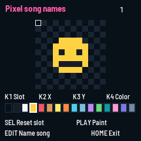

# Song slots and pixel names

- **GLO → K3** previews slots 1–3. The knob stops at both ends. **EDIT** opens the previewed slot, with its instruments, presets, settings and recordings.
- **SAVE** writes to the loaded slot. A fresh shelf starts at slot 1. If the shelf already contains songs when you start the emulator, open a slot first. To make a new song while another is loaded, open an empty slot.
- **K4** in either direction asks to delete the song in the preview. **EDIT** confirms. **HOME** cancels. The prompt also closes after five seconds. If you delete the loaded slot, your playing copy remains open and can be saved again.
- **Hold HOME and turn K1** left to undo or right to redo. The last ten actions can include saves, overwrites, deletes and names. History resets when the emulator restarts.

## Make a pixel name

Hold **EDIT** in GLO. The editor has ten starter symbols and five blank canvases.




| Control | Action |
| --- | --- |
| K1 | Choose a template, 1–15 |
| K2 / K3 | Move across columns / rows |
| K4 | Select a color and paint the current pixel |
| PLAY | Paint with the selected color |
| SEL | Reset the template to its original symbol or blank canvas |
| EDIT | Name the loaded song |
| HOME | Exit to the shelf |

The first palette swatch erases. Template edits save automatically. Naming a saved song changes only its picture. A new song's name is included with its first SAVE. Each song keeps a copy of its picture, so editing or resetting a template leaves existing names intact.

The name is a 12×12 icon in the top bar where P1 used to be. P1 identified the sequencer’s active pattern number. The icon also appears when previewing a saved song in GLO.

The fifteen templates use 1,080 bytes of packed pixels, and each song name adds 76 bytes including its checksum. Existing songs open with their music intact and can be named in the new editor.

## Run the Mac emulator

From the repository checkout:

```sh
git fetch origin feat/kids-pixel-song-names:refs/remotes/origin/feat/kids-pixel-song-names
git switch --track origin/feat/kids-pixel-song-names
PYTHON="$PWD/.venv/bin/python" ./build.sh --web &&
python3 -m http.server 8000 --bind 127.0.0.1 --directory app/build/emu
```

Open [127.0.0.1:8000](http://127.0.0.1:8000). Browser songs and templates are stored in IndexedDB for that browser profile and origin.
