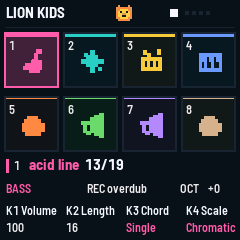

# LION KIDS release review

The software release candidate is the browser emulator. The GitHub Actions workflow builds it from a recursive checkout using public build dependencies and uploads the web directory. No instrument, private sample bank or files from a particular computer are needed. The emulator's IndexedDB contains local songs and canvases. The browser creates that data at runtime.

## Starter sounds and controls

| Track | Preset | Category |
| --- | --- | --- |
| 1 | Acid line | Bass |
| 2 | Marimba | Plucks |
| 3 | Twill | Drums |
| 4 | Bellows | Keys |
| 5 | Dusty pad | Pads |
| 6 | Breath lead | Leads |
| 7 | Flute | Leads |
| 8 | Whisper pad | Pads |

Each track icon follows its category. PRESETS changes categories and ALGORITHM moves through that category. The counter beside the sound name shows the current position and total, such as **5/17**. Keys and Plucks start with delay and reverb. You can adjust both while playing. Selecting a category outside that pair turns both off on the track. Your saved songs retain their sounds, switches and pixel names. The new smiley is the starter image for slot 2.

## Hardware review

The inherited platform recognizes two 1 MiB flash parts. The stock Puya P25Q80 reports JEDEC ID `856014`. Later units use the UC25HQ80, ID `B36014`. The host test accepts both and rejects unknown parts, for which the platform uses RAM-only operation. The bootloader, flash map, package identity and platform submodule revisions are unchanged.

The existing hardware target builds LOOM-8 Studio. Using the JieLi toolchain and hash-verified AC79 SDK files, the offline Studio build occupied 581,536 of the 581,564 bytes in the application slot and left 2,096 bytes of SRAM free. Removing an unused scope recorder reduced the image to 581,472 bytes and increased free SRAM to 2,616 bytes. The offline build passed the simulated update-entry and loader tests and the JEDEC allowlist test for both flash parts.

An isolated compile with the Kids interface and audio enabled exceeded SRAM by 98,600 bytes at link time, even with Kids song writes stubbed out. Turning off Bluetooth, USB audio, USB host and screen mirroring reduced that overage to 26,824 bytes. Neither probe produced a firmware package. The device build also lacks the heap API used by the current Kids song and history code. The largest additional allocations are the audio mix and insert buffers and the two undo capture buffers. The LION KIDS interface and song storage ship in the emulators. The inherited device workflow remains scoped to upstream LOOM-8.

A follow-up probe kept the audio path and removed Studio's input and drawing entry points from the device build. This recovered 2,920 bytes of SRAM and about 121 KiB of linked code and read-only data. Drawing the Kids display in strips of up to 64 rows instead of reserving 120 rows recovered another 26,880 bytes. Ten host screenshots matched pixel for pixel across the stage, sequencer, song shelf, naming editor and shaping views. The 20 WAV files produced by those scenarios were byte-identical. These are measurements from separate prototypes. The display change still needs device timing measurements, and the device build still needs allocation and persistent song storage. The resulting static margin of about 3 KiB is insufficient for the emulator's current song codec, which allocates whole-song buffers.

The save encoder now streams segments of the working song into the existing format. It measures compression first, then allocates only the final encoded record. A synthetic six-track, 64-step song with chords, kit hits, both sends and quick effects occupied 5,804 bytes encoded (76,872 bytes decoded). The emulator saved it, reopened it in a new process, verified notes, velocity and sends, and played it for ten seconds while leaving the slot bytes unchanged. The final record and decoder still need RAM in the emulator implementation. The device path needs a direct sink, bounded loading and a device-specific edit history.

The current flash map has no verified unassigned region large enough for a song shelf. One layout to evaluate uses 96 KiB of the contiguous 108 KiB user-sample window for three slots with two 16 KiB copies apiece. The remaining sectors in that window could hold the metadata journal. Each song would have less than 16 KiB of payload capacity after headers. The dense test song fits that example budget, and a dense song with additional saved pattern banks could require more. Choosing this region would affect imported samples. The project pool, calibration, factory sound resources and updater stay separate in this candidate layout. No region has been assigned to Kids writes.

Before publishing an FM-1 install link:

1. Reduce the Kids mix and insert scratch space, replace bulk undo captures with bounded edits, and port the interface and panel handling to the device target. Give Kids songs an atomic flash backend and verify that saving, clearing and Undo preserve calibration, Studio songs and unrelated slots. The current device map already allocates the data region.
2. Build with the pinned JieLi toolchain and SDK. Record the device image size, SRAM headroom and worst-case audio load. Run the offline package and update tests for the stock Puya and later UC flash parts, including interrupted updates.
3. Verify boot, save, clear, reboot and stock recovery on both hardware revisions before publishing. Give LION KIDS its own package identity and point the installer and Firmware Hub manifest to that verified package.

[Mac emulator instructions](DELIVERY_8.md)
